# ☁️ CloudCost Guardian — DevOps-Driven Cloud Cost Optimization Platform

<p align="center">
  
  
  
  
  
  
</p>

<p align="center">
  <b>Automate. Deploy. Monitor. Optimize.</b>
</p>

<p align="center">
  A DevOps-focused platform that combines containerized application delivery, CI/CD automation, cloud resource observability, infrastructure cost analysis, and optimization recommendations in a unified engineering workflow.
</p>

<p align="center">
  <a href="https://github.com/pothireddybhavyasri/cloudcost-guardian">Repository</a> •
  <a href="https://github.com/pothireddybhavyasri/cloudcost-guardian/actions/workflows/ci.yml">CI/CD Pipeline</a> •
  <a href="https://github.com/pothireddybhavyasri/cloudcost-guardian/blob/main/docs/ARCHITECTURE.md">Architecture</a> •
  <a href="https://github.com/pothireddybhavyasri/cloudcost-guardian/blob/main/docs/COLLEGE_PROJECT_REPORT.md">Project Report</a>
</p>

---

## 🚀 1. Project Overview

CloudCost Guardian is a DevOps and FinOps engineering project designed to demonstrate how software can be built, tested, packaged, deployed, monitored, and optimized through an automated delivery lifecycle.

Modern cloud applications require more than working source code. They need repeatable builds, reliable deployments, application health checks, resource monitoring, security controls, and continuous cost awareness.

CloudCost Guardian brings these concerns together through a web application, an optional Go backend, container orchestration, automated CI checks, and cloud resource optimization logic.

### 🎯 Engineering Objectives

- Automate application verification through a CI pipeline.
- Package application components into Docker containers.
- Orchestrate application and supporting services using Docker Compose.
- Establish a repeatable local deployment workflow.
- Validate code quality using TypeScript checks and automated tests.
- Monitor application health, logs, resource utilization, and cost indicators.
- Identify potentially idle infrastructure and rightsizing opportunities.
- Apply DevSecOps practices to credentials, dependencies, and deployment permissions.
- Create a foundation for Infrastructure as Code and continuous delivery.

**Project:** CloudCost Guardian  
**Developer:** Pothireddy Bhavya Sri  
**Domain:** DevOps | Cloud Computing | CI/CD | FinOps  
**Project Type:** Computer Science Engineering Capstone Project

---

## 🛠️ 2. DevOps Technology Stack

| DevOps Area | Technology | Engineering Purpose |
|---|---|---|
| Version Control | Git, GitHub | Source control and collaboration |
| CI/CD | GitHub Actions | Automated verification on repository changes |
| Containerization | Docker | Reproducible application environments |
| Orchestration | Docker Compose | Multi-container local deployment |
| Frontend | Next.js 15, TypeScript | Web application and dashboard |
| Backend | Go 1.23 | Optional REST API microservice |
| Database | PostgreSQL / TimescaleDB | Persistent application and time-series data |
| Caching | Redis | Optional caching layer |
| Testing | Vitest | Automated unit tests |
| Static Validation | TypeScript compiler | Type and code validation |
| Cloud Operations | AWS, Azure, GCP concepts | Multi-cloud resource visibility and optimization |
| Infrastructure as Code | Terraform — planned extension | Repeatable infrastructure provisioning |
| Monitoring | Health checks, logs, metrics — implementation-dependent | Operational visibility |
| Security | Secrets management, least privilege — implementation-dependent | Safer software delivery |

> **Implementation status matters:** GitHub Actions, Docker, and Docker Compose are part of the project's described setup. Terraform, production-grade monitoring, cloud deployment automation, and live provider integrations should be listed as implemented only after the relevant configurations and workflows exist.

---

## 🔄 3. End-to-End DevOps Lifecycle

CloudCost Guardian follows the software delivery lifecycle from a code change to a validated deployment.

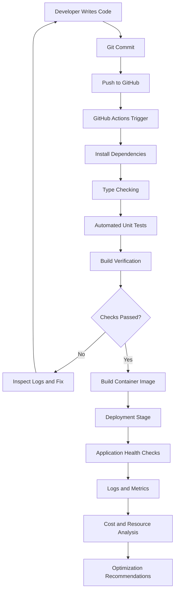

### Lifecycle Explanation

1. **Develop:** Implement features and update application code.
2. **Version:** Track changes using Git and GitHub.
3. **Integrate:** Trigger GitHub Actions after supported repository events.
4. **Validate:** Run dependency installation, type checking, tests, and configured build checks.
5. **Package:** Build container images when container packaging is included in the pipeline.
6. **Deploy:** Run the application locally or deploy it to a configured environment.
7. **Verify:** Check application availability and service health.
8. **Observe:** Inspect logs, metrics, errors, and resource consumption.
9. **Optimize:** Identify infrastructure waste and estimate potential cost savings.

The actual CI pipeline should be treated as the source of truth for which steps execute automatically.

---

## ⚙️ 4. CI/CD Pipeline Automation

The project includes a GitHub Actions workflow at:

[`/.github/workflows/ci.yml`](https://github.com/pothireddybhavyasri/cloudcost-guardian/blob/main/.github/workflows/ci.yml)

### CI/CD Workflow Visualization

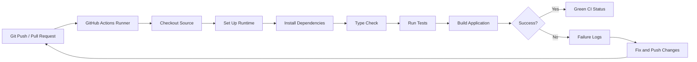

### Automated Quality Gates

| Quality Gate | Purpose |
|---|---|
| Dependency installation | Reconstruct the development environment |
| Type checking | Detect TypeScript errors |
| Unit tests | Verify application logic |
| Build verification | Detect production build failures |
| Workflow status | Show whether the configured checks succeeded |

### Run the Checks Locally

From the repository root:

```bash
cd frontend
npm install
npm run type-check
npm test
npm run build
```

The build command should be run if it is configured in `frontend/package.json`.

### View CI/CD Execution

Open the GitHub Actions workflow:

https://github.com/pothireddybhavyasri/cloudcost-guardian/actions/workflows/ci.yml

Use the workflow run details to demonstrate:

- Trigger events.
- Job and step execution.
- Successful and failed checks.
- Error logs.
- Verification after a code change.

**DevOps demonstration:** Make a small, valid code change, push it to a feature branch, open a pull request, and show the CI checks running automatically. Avoid introducing deliberate failures to the default branch.

---

## 🐳 5. Containerization with Docker

Docker packages an application and its runtime dependencies into a reproducible image.

For CloudCost Guardian, containerization supports consistent environments across development, testing, and deployment.

### Container Architecture

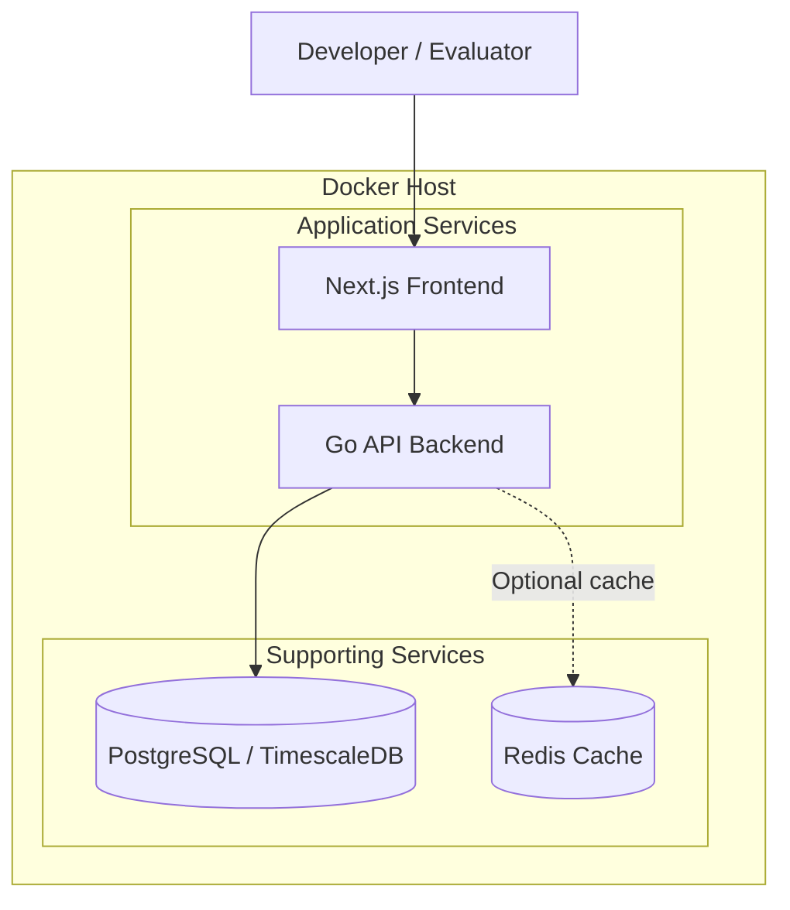

### Start the Containerized Environment

Run the following commands from the repository root, where `docker-compose.yml` is located.

```bash
# Build images and start configured services
docker compose up -d --build

# Check service status
docker compose ps

# Inspect logs
docker compose logs --tail=100

# Follow logs continuously
docker compose logs -f
```

### Useful Docker Commands

```bash
# List running containers
docker ps

# List available images
docker images

# Inspect service health and status
docker compose ps

# Restart the application stack
docker compose restart

# Stop containers and networks
docker compose down
```

### What to Demonstrate

- Docker image creation.
- Container startup and shutdown.
- Port mapping and service connectivity.
- Environment variable configuration.
- Application logs.
- Service restart behavior.
- Database persistence, if configured.

The actual services, exposed ports, health checks, and persistence behavior depend on `docker-compose.yml` and the individual Dockerfiles.

---

## ☁️ 6. Cloud Resource Monitoring and FinOps

DevOps teams need to understand not only whether their applications work, but also how much the infrastructure costs and whether allocated resources are being used efficiently.

CloudCost Guardian adds a FinOps layer to the operational workflow.

### Cloud Resource Monitoring Flow

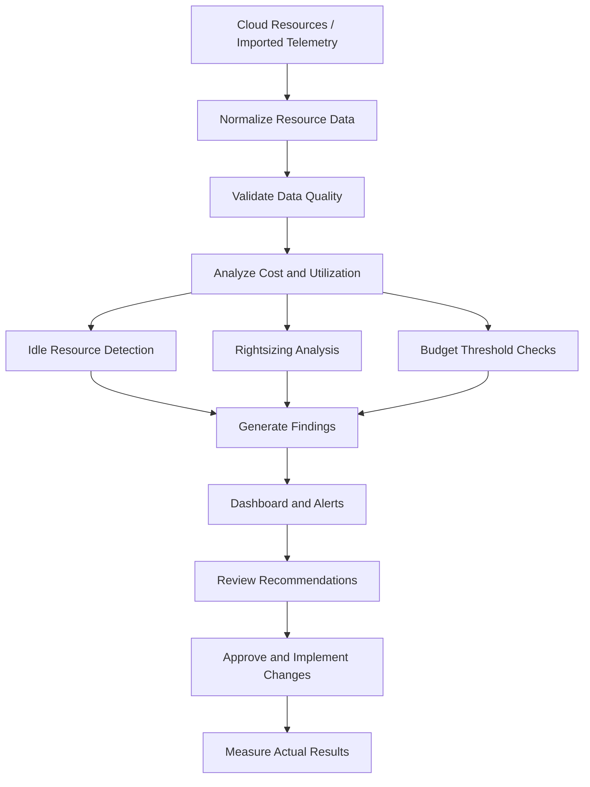

### Resource Categories

| Provider | Example resource types |
|---|---|
| AWS | EC2, EBS, RDS, S3, Lambda |
| Azure | Virtual Machines, Azure SQL, Blob Storage |
| GCP | Compute Engine, Cloud Storage, Cloud Run |

These are supported resource categories in the project's intended design. Live monitoring requires working integrations, valid credentials, permissions, and provider-specific telemetry.

### Optimization Capabilities

- Identify unattached storage volumes.
- Flag stopped virtual machines that may still incur charges.
- Detect low CPU utilization over a configurable observation period.
- Identify potential overprovisioning.
- Estimate savings from suggested resource configurations.
- Flag budget threshold violations.
- Export inventory and recommendations for review.

### Savings Calculation

For a simple hourly pricing model:

\[
\text{Monthly Savings} =
(\text{Current Hourly Cost} - \text{Suggested Hourly Cost}) \times 720
\]

\[
\text{Annual Savings} =
\text{Monthly Savings} \times 12
\]

The 720-hour factor assumes a standardized 30-day month. Actual savings depend on pricing, commitments, usage, and implementation constraints.

**Operational safeguard:** Recommendations should be reviewed before applying changes to production infrastructure. The platform must not assume that low CPU utilization alone makes a resource safe to terminate.

---

## 📊 7. Operational Analytics and Visualizations

CloudCost Guardian can bring together operational indicators and cost information to support infrastructure decisions.

### A. Observability Pipeline

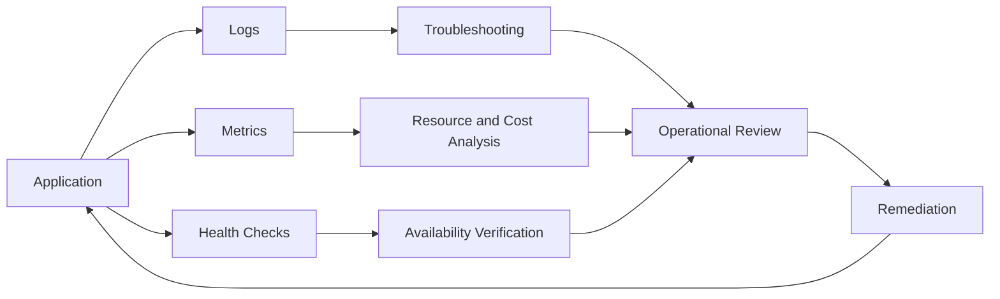

This illustrates an observability design. Centralized log aggregation, Prometheus, Grafana, distributed tracing, and production alerting require their own implementation and configuration.

### B. Example Infrastructure Cost Distribution

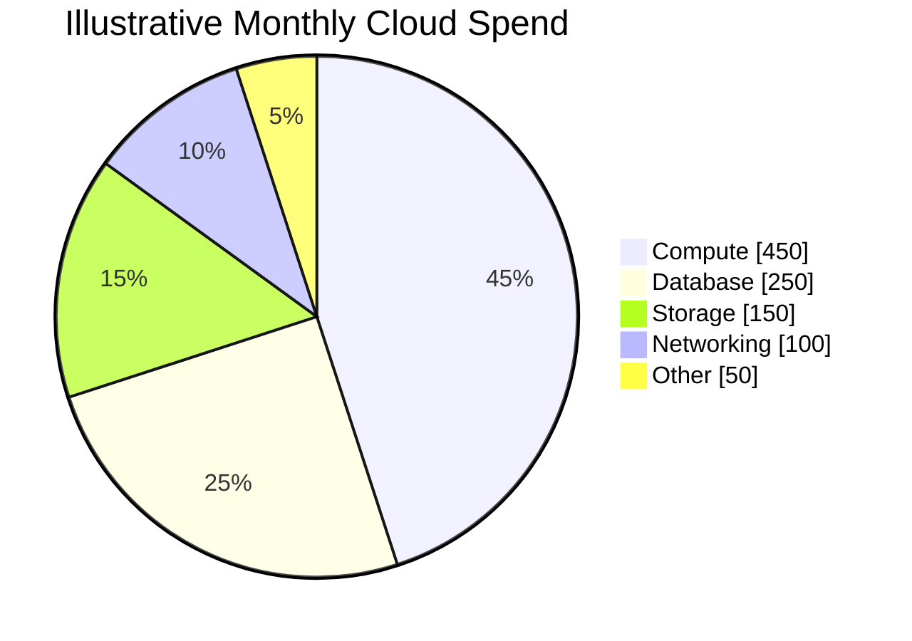

The chart is illustrative, with a total of $1,000. Replace it with measured billing data before presenting it as an actual project result.

### C. Example Resource Optimization

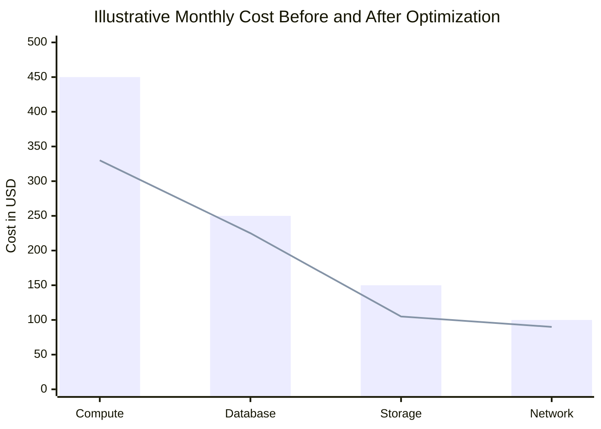

The bars represent an example baseline and the line represents a hypothetical optimized scenario. Neither series represents verified savings from a live environment.

### D. Incident-to-Resolution Workflow

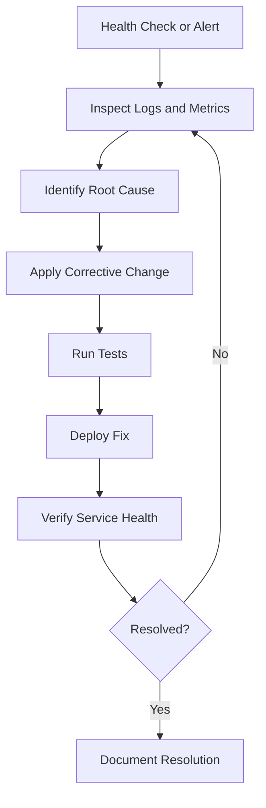

---

## 🛡️ 8. DevSecOps and Deployment Safety

Security should be part of the delivery lifecycle rather than an activity performed only before deployment.

### Security Controls

- Store secrets in environment variables or an appropriate secrets manager.
- Never commit cloud credentials, access tokens, or private keys.
- Use least-privilege IAM permissions.
- Validate API requests and imported resource records.
- Keep dependencies updated and review known vulnerabilities.
- Restrict access to protected application routes.
- Avoid embedding privileged credentials into frontend code.
- Review container images and runtime permissions.
- Preserve logs for important operational changes.
- Require human approval for destructive infrastructure changes.

### Security Workflow

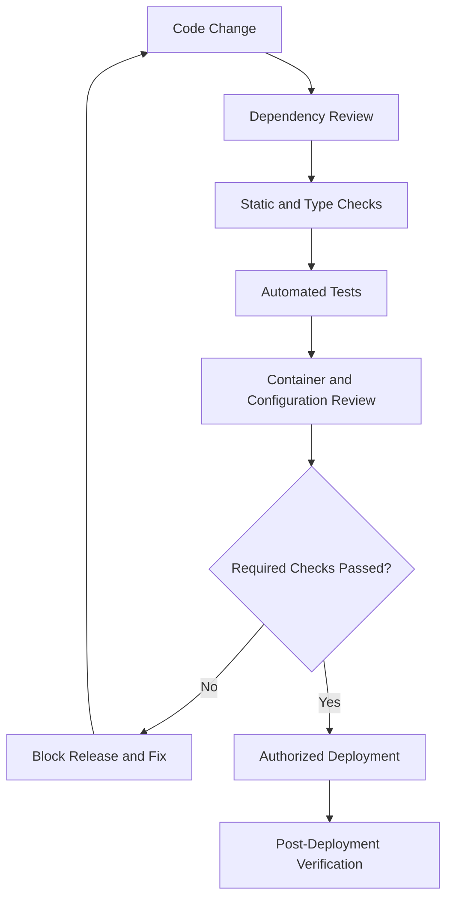

Dependency vulnerability scanning, container scanning, secret scanning, and deployment approvals should be described as automated controls only after they are configured in the repository.

---

## 🏗️ 9. Infrastructure as Code — Extension Roadmap

Terraform can extend CloudCost Guardian by provisioning reproducible infrastructure rather than requiring manual setup.

### Proposed Terraform Workflow

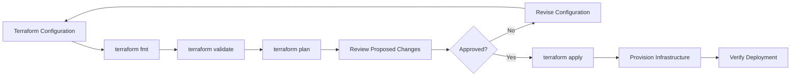

### Proposed IaC Capabilities

- Provision a cloud-hosted application environment.
- Define networking and security groups.
- Configure a database service.
- Create environment-specific resource configurations.
- Manage infrastructure changes through version control.
- Review Terraform plans before applying changes.
- Destroy temporary demonstration infrastructure when no longer needed.

**Status:** This is a proposed extension unless Terraform files and working provisioning workflows already exist in the repository.

---

## 🔁 10. Complete DevOps Project Workflow

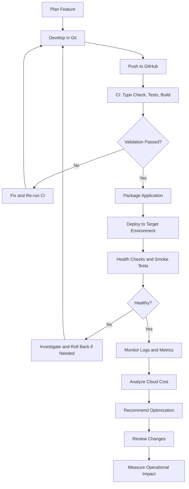

This is the end-to-end engineering workflow the project aims to demonstrate. Automated rollback, production deployment, and post-deployment monitoring should be treated as future work unless they are implemented.

---

## 📁 11. Repository Structure

```text
cloudcost-guardian/
│
├── .github/
│   └── workflows/
│       └── ci.yml
│
├── backend/
│   ├── cmd/
│   │   └── api/
│   │       └── main.go
│   ├── internal/
│   │   └── services/
│   └── Dockerfile
│
├── frontend/
│   ├── app/
│   │   ├── accounts/
│   │   ├── alerts/
│   │   ├── analytics/
│   │   ├── dashboard/
│   │   ├── data-quality/
│   │   ├── idle/
│   │   ├── recommendations/
│   │   ├── reports/
│   │   ├── resources/
│   │   └── api/
│   ├── components/
│   ├── lib/
│   │   ├── api.ts
│   │   └── guardian-engine.ts
│   └── tests/
│
├── docs/
│   ├── ARCHITECTURE.md
│   └── COLLEGE_PROJECT_REPORT.md
│
├── docker-compose.yml
├── LICENSE
└── README.md
```

This is the expected layout; keep it aligned with the actual tracked files.

---

## 🚀 12. Quick Start

### Prerequisites

- Git
- Node.js version supported by the project
- npm
- Docker Desktop and Docker Compose for the containerized setup
- Go for independent backend development

### Step 1 — Clone the repository

```bash
git clone https://github.com/pothireddybhavyasri/cloudcost-guardian.git
cd cloudcost-guardian
```

### Step 2 — Install dependencies

```bash
cd frontend
npm install
```

### Step 3 — Run quality checks

```bash
npm run type-check
npm test
npm run build
```

Run only commands configured in the frontend package scripts.

### Step 4 — Launch the application

```bash
npm run dev
```

Open:

http://localhost:3000

### Step 5 — Start the containerized environment

From the project root:

```bash
docker compose up -d --build
docker compose ps
docker compose logs --tail=100
```

### Step 6 — Stop the services

```bash
docker compose down
```

---

## 🧪 13. Testing and Validation Strategy

| Test Category | What it validates |
|---|---|
| Unit testing | Cost calculations and resource detection logic |
| Type checking | TypeScript correctness |
| Build verification | Production compilation |
| API testing | Request handling and error responses |
| Container validation | Startup and service configuration |
| Health checks | Application and dependency availability |
| Integration testing | Communication between application services |
| Security checks | Dependency, secret, and configuration risks |
| Deployment verification | Application availability after release |
| Cost validation | Accuracy of estimates against source billing data |

### Demonstration Checklist

- [ ] Start the application locally.
- [ ] Run the automated test suite.
- [ ] Show the GitHub Actions workflow.
- [ ] Push a small change and observe the CI run.
- [ ] Build and start Docker services.
- [ ] Inspect service status and application logs.
- [ ] Demonstrate resource inventory and optimization recommendations.
- [ ] Explain the distinction between simulated and live telemetry.
- [ ] Show the project architecture and operational workflow.
- [ ] Discuss security controls and future infrastructure automation.

---

## 📈 14. Measuring DevOps Success

Evaluate the project using actual measurements instead of unsupported performance claims.

| Engineering Metric | Measurement |
|---|---|
| CI success rate | Successful workflow runs / total completed runs |
| Test pass rate | Passed tests / total executed tests |
| Build duration | Time taken for a clean build |
| Deployment duration | Time from deployment start to successful verification |
| Change failure rate | Failed deployments / total deployments |
| Recovery time | Time required to restore a failed service |
| Application availability | Successful health checks / total checks |
| Resource waste | Verified idle or underutilized resources |
| Savings accuracy | Estimated savings compared with actual billing changes |
| Security findings | Number and severity of unresolved findings |

These metrics create a basis for comparing future improvements. Establish a baseline and record the results from actual test runs.

---

## 🗺️ 15. Future DevOps Enhancements

- [ ] Automated Docker image build and publishing.
- [ ] Continuous deployment to a cloud environment.
- [ ] Terraform-based infrastructure provisioning.
- [ ] Prometheus metrics collection.
- [ ] Grafana dashboards and operational alerts.
- [ ] Centralized logging.
- [ ] Container vulnerability scanning.
- [ ] Dependency and secret scanning in CI.
- [ ] Deployment approval gates.
- [ ] Automated smoke tests after deployment.
- [ ] Health-based rollback strategy.
- [ ] Kubernetes deployment and Helm charts.
- [ ] Live AWS, Azure, and GCP billing integrations.
- [ ] FinOps reports based on verified cloud billing data.

---

## 📚 16. Project Documentation

- [Source Code](https://github.com/pothireddybhavyasri/cloudcost-guardian)
- [GitHub Actions Workflow](https://github.com/pothireddybhavyasri/cloudcost-guardian/blob/main/.github/workflows/ci.yml)
- [Architecture Documentation](https://github.com/pothireddybhavyasri/cloudcost-guardian/blob/main/docs/ARCHITECTURE.md)
- [College Project Report](https://github.com/pothireddybhavyasri/cloudcost-guardian/blob/main/docs/COLLEGE_PROJECT_REPORT.md)
- [Apache License 2.0](https://github.com/pothireddybhavyasri/cloudcost-guardian/blob/main/LICENSE)

---

## 👩‍💻 17. Author

**Pothireddy Bhavya Sri**  
Computer Science Engineering  
ACE Engineering College, Hyderabad

Interested in DevOps engineering, cloud infrastructure, automation, software delivery, and FinOps.

<p align="center">
  <a href="https://github.com/pothireddybhavyasri">
    
  </a>
  <a href="https://www.linkedin.com/in/pothireddy-bhavya-sri-031193328/">
    
  </a>
</p>

---

## 🖥️ 18. Live Application Demo & Output Screenshots

Explore the deployed CloudCost Guardian platform and its operational dashboards.

**Live Dashboard:** https://frontend-seven-eta-22.vercel.app/dashboard

### Executive Dashboard

The central overview for cloud resource health, projected spending, savings opportunities, and operational alerts.

<p align="center">
  <a href="https://frontend-seven-eta-22.vercel.app/dashboard">
    
  </a>
</p>

### Resource Inventory

View cloud resources, provider classifications, resource health, utilization, and monthly cost estimates.

<p align="center">
  <a href="https://frontend-seven-eta-22.vercel.app/resources">
    
  </a>
</p>

### Utilization Analytics

Explore the CPU, memory, storage, and network metrics used to evaluate resource utilization.

<p align="center">
  <a href="https://frontend-seven-eta-22.vercel.app/analytics">
    
  </a>
</p>

### Idle Resource Detection

Review potentially idle compute resources, unattached volumes, and estimated recoverable spending.

<p align="center">
  <a href="https://frontend-seven-eta-22.vercel.app/idle">
    
  </a>
</p>

### Optimization Engine

Inspect rightsizing recommendations, estimated return on investment, and potential savings.

<p align="center">
  <a href="https://frontend-seven-eta-22.vercel.app/recommendations">
    
  </a>
</p>

### Threshold Alerts

Review budget thresholds, anomaly indicators, and operational alert information.

<p align="center">
  <a href="https://frontend-seven-eta-22.vercel.app/alerts">
    
  </a>
</p>

### Data Quality & Ingestion

Inspect telemetry validation, schema checks, ingestion quality, and synthetic-data provenance.

<p align="center">
  <a href="https://frontend-seven-eta-22.vercel.app/data-quality">
    
  </a>
</p>

### Cloud Accounts & Reporting

- [Cloud Accounts](https://frontend-seven-eta-22.vercel.app/accounts) — cloud account configuration interface.
- [CSV Reports](https://frontend-seven-eta-22.vercel.app/reports) — resource inventory and optimization report exports.

> **Screenshot note:** Capture these images from the running application and save them under `docs/screenshots/`. Keep synthetic demonstration data clearly labelled; do not present simulated values as verified live cloud telemetry.
> 

## 📄 License

Licensed under the Apache License 2.0. See the [LICENSE](https://github.com/pothireddybhavyasri/cloudcost-guardian/blob/main/LICENSE) file for details.

<p align="center">
  <b>CloudCost Guardian</b>
  <br/>
  Building reliable delivery pipelines. Operating cloud infrastructure responsibly. Optimizing costs continuously.
</p>

