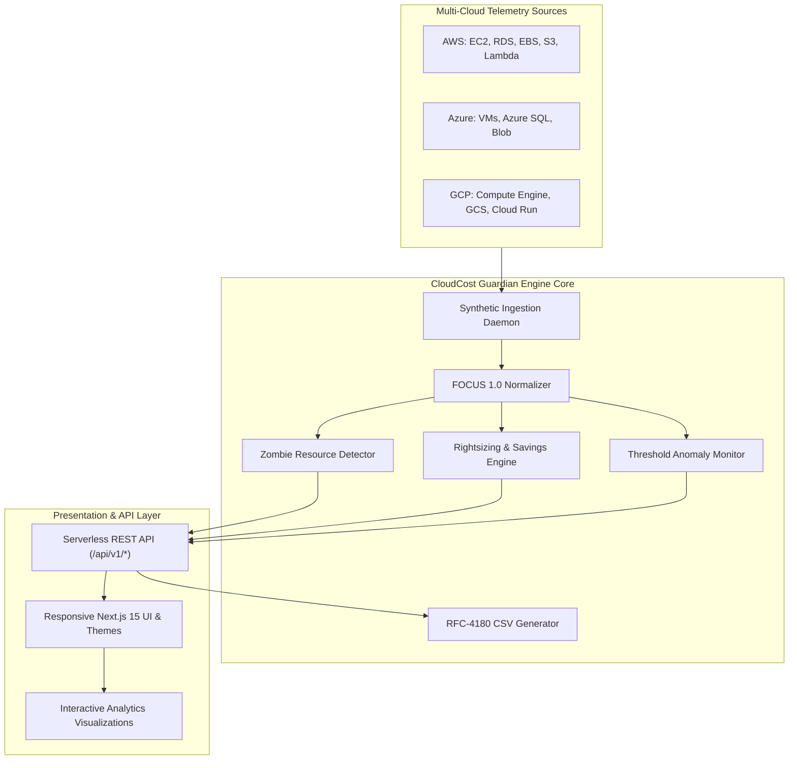

# CloudCost Guardian — Cloud Resource Usage & Optimization Platform

[](https://github.com/pothireddybhavyasri/cloudcost-guardian/actions/workflows/ci.yml)
[](docs/COLLEGE_PROJECT_REPORT.md)
[](LICENSE)
[](https://nextjs.org)
[](https://www.typescriptlang.org)
[](https://focus.finops.org)

> **Autonomous multi-cloud cost observability, zombie resource detection, rightsizing engine, and budget governance across AWS, Microsoft Azure, and Google Cloud Platform.**

Developed as a College Computer Science Engineering Capstone Project by **Pothireddy Bhavya Sri**.

---

## 🌟 Key Platform Features

- 🛡️ **Multi-Cloud Fleet Telemetry:** Unified monitoring and cost attribution for AWS (EC2, RDS, EBS, S3, Lambda), Microsoft Azure (VMs, Azure SQL, Blob), and GCP (Compute Engine, Cloud Storage, Cloud Run).
- 💤 **Automated Idle & Zombie Resource Detection:** Detects unattached storage disks, stopped virtual machines incurring storage charges, and zombie workloads with $<5\%$ CPU utilization over 7+ days.
- 💡 **Algorithmic Rightsizing Engine:** Projections of monthly and annual ROI savings calculated using the standard 720 hours/month basis with step-by-step operational runbooks.
- 🚨 **Threshold-Based Alerts System:** Real-time triggers for budget overruns, high-cost resource anomalies ($>\$400$/mo), and compute stress bottlenecks ($>90\%$ CPU).
- 📈 **Utilization Analytics:** 24-hour time-series charts tracking CPU %, Memory (RAM) %, Storage allocation, and Network Throughput in Mbps.
- 🛡️ **Continuous Data Quality Audit:** Automated pipeline monitoring validating schema compliance, null value checks, non-negative bounds, and non-production synthetic watermarks.
- 📥 **RFC-4180 CSV Data Export:** Instant one-click downloads for full fleet inventory and optimization recommendations for spreadsheet audits.
- 🚀 **One-Click Faculty Demo Access:** Instant guest bypass button on `/login` enabling instant evaluation of the platform without credential setup.

---

## 🏗️ Architecture & Dual-Mode Execution

CloudCost Guardian implements a resilient dual-mode architecture:
1. **Serverless Mode (Zero-Dependency Local & Cloud):** Powered by Next.js 15 App Router with full-stack serverless API route handlers (`/api/v1/*`). Runs locally with only Node.js installed or deployed directly to Vercel with zero database setup required.
2. **Containerized Microservices Mode:** Includes the Go 1.23 REST API microservice (`backend/`), TimescaleDB / PostgreSQL time-series storage, Redis caching, and Docker Compose orchestration.



---

## 🚀 Quick Start Guide

### Prerequisites
- **Node.js:** v20.x, v22.x, or v24.x
- **npm:** v10.x or v11.x

*(Docker and Go are optional — the platform executes standalone with Node.js).*

### 1. Clone the Repository
```bash
git clone https://github.com/pothireddybhavyasri/cloudcost-guardian.git
cd cloudcost-guardian
```

### 2. Install Frontend Dependencies
```bash
cd frontend
npm install
```

### 3. Run Automated Unit Tests & Type Check
```bash
npm run type-check   # Verifies TypeScript integrity (0 errors)
npm test             # Executes 20 automated Vitest unit tests
```

### 4. Launch Development Server
```bash
npm run dev
```
Open **[http://localhost:3000](http://localhost:3000)** in your browser.

- Click **"Launch Instant Demo Dashboard"** on `/login` to access the full platform immediately.

---

## 🐳 Docker Deployment (Optional)

When Docker and Docker Compose are installed:

```bash
# Build and start all 4 services (Frontend, Backend, PostgreSQL, Redis)
docker compose up -d

# Verify container health
docker compose ps
```

---

## 🧪 Automated Testing & Verification

The project includes an automated test suite verifying mathematical calculations, idle detection heuristics, threshold alerting, and CSV serialization:

```bash
cd frontend
npm test
```

### Verified Test Cases:
- `Test 1-4`: Cost savings calculation and negative bound protection ($S = (C_{curr} - C_{sugg}) \times 720$).
- `Test 5-9`: Idle resource detection (unattached volumes, stopped VMs, compute $<5\%$ CPU for $\ge 7$ days).
- `Test 10-12`: Rightsizing and storage tiering recommendations.
- `Test 13-14`: Threshold budget overrun and orphan disk alerting.
- `Test 15-18`: Multi-cloud synthetic telemetry consistency and 24h metrics.
- `Test 19-20`: RFC-4180 CSV escaping and header compliance.

---

## 📁 Repository Structure

```
cloudcost-guardian/
├── .github/workflows/ci.yml       # GitHub Actions CI/CD matrix pipeline
├── backend/                       # Go 1.23 REST API microservice
│   ├── cmd/api/main.go            # Go HTTP entrypoint
│   ├── internal/services/         # Rightsizing algorithms
│   └── Dockerfile                 # Go container build
├── frontend/                      # Next.js 15 Full-Stack Application
│   ├── app/                       # App Router pages & /api/v1/ serverless routes
│   │   ├── accounts/              # Cloud accounts view
│   │   ├── alerts/                # Threshold alerts view
│   │   ├── analytics/             # Utilization time-series view
│   │   ├── dashboard/             # Executive overview view
│   │   ├── data-quality/          # Data quality audit view
│   │   ├── idle/                  # Idle & zombie detection view
│   │   ├── recommendations/       # Rightsizing view
│   │   ├── reports/               # CSV reports download view
│   │   └── resources/             # Fleet inventory view
│   ├── components/                # Modular UI & Layout components
│   ├── lib/
│   │   ├── api.ts                 # Typed client API client
│   │   └── guardian-engine.ts     # Guardian core calculation engine
│   └── tests/                     # Automated Vitest test suite
├── docs/
│   ├── ARCHITECTURE.md            # Detailed architectural specifications
│   └── COLLEGE_PROJECT_REPORT.md  # Comprehensive academic project report
├── docker-compose.yml             # 4-tier container orchestration
├── LICENSE                        # Apache 2.0 License
└── README.md
```

---

## 📄 License & Attribution

This project is licensed under the **Apache License 2.0**.
Derived in part from open-source foundations with copyright retained by original upstream authors (Oseghale Paul Okosun, 2026). Substantially extended, customized, and transformed into **CloudCost Guardian** by **Pothireddy Bhavya Sri** for academic evaluation. See `docs/COLLEGE_PROJECT_REPORT.md` for a complete audit of original contributions.
